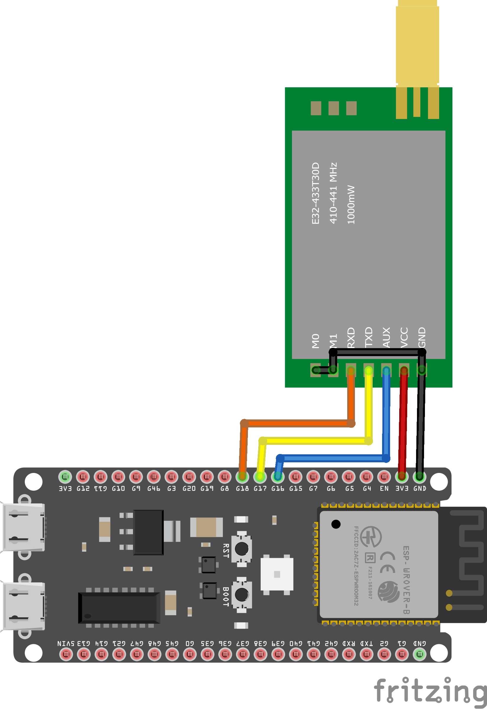

<div align="center">

# 🛡️⚡ Kπyρτόn_wave~ (κρυπτόν_wave~)
### *Post-Quantum Cryptographic Networking Experiment & Real-Time Traffic Laboratory*

[;Live+Wireshark+Packet+Inspection+Mode)](https://git.io/typing-svg)

<p align="center">
  
  
  
  
</p>

<p align="center">
  
  
  
  
  
  
</p>

<p align="center">
  <a href="#-whats-new-in-kπyρτόn_wave">What's New</a> •
  <a href="#-cryptographic-stack--specifications">Cryptographic Stack</a> •
  <a href="#-the-3-interactive-protocol-toggles">Interactive Toggles</a> •
  <a href="#-5-step-pqc-handshake-protocol">Handshake Protocol</a> •
  <a href="#-real-wireshark-packet-capture-experiment">Wireshark Guide</a> •
  <a href="#-hardware-schematic--circuit-design">Hardware & Circuit</a> •
  <a href="#-running-the-application">Running</a>
</p>


</div>

---

## 🚀 What's New in Kπyρτόn_wave~ (Latest Update)

> [!IMPORTANT]
> The project has evolved from a basic encrypted messenger into **`Kπyρτόn_wave~`**—a fully functional **post-quantum cryptographic networking experiment**. Every toggle directly alters the raw TCP socket packets captured in the standalone **Wireshark** application.

```
┌──────────────────────────────────────────────────────────────────────────────────┐
│                             WHAT CHANGED IN THIS UPDATE                          │
├──────────────────────────────────────────────────────────────────────────────────┤
│  1. NIST FIPS 206 Falcon-512  │ Upgraded from Ed25519 to genuine post-quantum    │
│                               │ Fast-Fourier lattice signatures (~660B).         │
│  2. Zero-HKDF Architecture    │ Removed HKDF-SHA256 completely; ML-KEM-768       │
│                               │ 32-byte shared secret maps directly to AES-256.  │
│  3. 3 Clean Protocol Toggles  │ ML-KEM-768, Falcon-512, AES-256-GCM with         │
│                               │ individual glowing control switches.             │
│  4. Embedded `pqc_data` Field │ Human-readable post-quantum layer hierarchy      │
│                               │ embedded directly inside every chat JSON frame.  │
│  5. Unsaved Peer Visibility   │ Real-time message reception, auto-activation,    │
│                               │ and bidirectional replies before saving contacts.│
│  6. Live Crypto Telemetry     │ Real-time log table showing raw packet size,     │
│                               │ IV/tag hex snippets, direction, and timestamps.  │
│  7. Electron ESM Bridge       │ Dynamic import loader solving ERR_REQUIRE_ESM.   │
│  8. Auto-Migration            │ Backs up legacy keys and regenerates Falcon-512. │
└──────────────────────────────────────────────────────────────────────────────────┘
```

---

## 🌟 Executive Summary

**`Kπyρτόn_wave~`** is a decentralized, zero-server desktop messenger and hardware gateway engineered for absolute immunity against **"Harvest Now, Decrypt Later" (HNDL)** quantum computing threats.

Traditional messaging systems rely on classical asymmetric cryptography (RSA, ECDH) to exchange session keys. These schemes are mathematically vulnerable to Shor's algorithm running on future Cryptanalytically Relevant Quantum Computers (CRQCs). `Kπyρτόn_wave~` eliminates this vulnerability by pairing **NIST FIPS 203 ML-KEM-768** post-quantum key encapsulation with **NIST FIPS 206 Falcon-512** digital signatures and **AES-256-GCM** authenticated payload encryption over direct peer-to-peer TCP networks and 433MHz LoRa physical links.

```
       ┌─────────────────────────────────────────────────────────────┐
       │             QUANTUM THREAT IMMUNITY ARCHITECTURE            │
       └──────────────────────────────┬──────────────────────────────┘
                                      │
              ┌───────────────────────┴───────────────────────┐
              ▼                                               ▼
   ┌──────────────────────┐                       ┌──────────────────────┐
   │  P2P Desktop Layer   │                       │  Hardware Gateway    │
   │  (Electron + React)  │                       │  (ESP32-S3 + LoRa)   │
   │  Direct TCP Sockets  │                       │  433T30D Long-Range  │
   └──────────┬───────────┘                       └──────────┬───────────┘
              │                                               │
              └───────────────────────┬───────────────────────┘
                                      │
                                      ▼
             ┌─────────────────────────────────────────────────┐
             │       FIPS 203 ML-KEM + FIPS 206 Falcon-512     │
             │           Post-Quantum Secure Tunnel            │
             └─────────────────────────────────────────────────┘
```

---

## 🔐 Cryptographic Stack & Specifications

<div align="center">

| Layer | Primitive / Standard | Security Parameters | Cryptographic Purpose |
|---|---|---|---|
| **Key Encapsulation** | **ML-KEM-768** | NIST FIPS 203 / Category 3 (~128-bit quantum security) | Quantum-safe session secret establishment |
| **Digital Signatures** | **Falcon-512** | NIST FIPS 206 / Category 1 lattice signatures | Handshake transcript authentication |
| **Payload Cipher** | **AES-256-GCM** | 256-bit Key, 96-bit IV, 128-bit Tag | AEAD message encryption & integrity |
| **Anti-Replay** | **Sequence Tracker** | 64-bit strictly monotonic counter | Replay attack & reordering defense |
| **Fingerprint** | **SHA-256 Digest** | Hex-formatted colon-delimited string | Out-of-band visual key verification |

</div>

<details>
<summary><b>🔬 Click to expand Mathematical Security Rationale & Key Sizes</b></summary>
<br />

### 1. Module Learning with Errors (MLWE) — ML-KEM-768
ML-KEM-768 bases its security on the hardness of the Module Learning with Errors problem over polynomial rings:
$$R_q = \mathbb{Z}_q[X]/(X^{256} + 1)$$
With matrix dimensions $k=3$ and modulus $q=3329$, ML-KEM-768 provides **NIST Security Category 3** protection ($>2^{128}$ quantum operations to break).
* **Public Key:** `1,184 bytes`
* **Ciphertext:** `1,088 bytes`
* **Shared Secret:** Exactly `32 bytes` (256 bits)

### 2. Fast Fourier Lattice Signatures — Falcon-512
Falcon-512 is based on the Short Integer Solution (SIS) problem over NTRU lattices using Fast Fourier orthogonalization and trapdoor Gaussian sampling.
* **Public Key:** `897 bytes` (FIPS 206 compliant)
* **Secret Key:** `1,281 bytes`
* **Signature Size:** `~660 bytes` (attached format)

### 3. Direct 32-Byte Key Mapping (Zero-HKDF)
ML-KEM-768 decapsulation already outputs a cryptographically uniform 32-byte secret (derived via SHAKE-256 internally). This 32-byte secret is mapped **directly** to the AES-256-GCM key with zero intermediate HMAC expansions.

### 4. Authenticated Encryption with Associated Data (AEAD)
Every message payload is encrypted under AES-256-GCM with a 96-bit random IV and sequence-numbered AAD. The 128-bit authentication tag guarantees that byte-flipping, truncation, or tampering triggers immediate socket rejection.
</details>

---

## 🎛️ The 3 Interactive Protocol Toggles

Inside the **Identity & Settings** screen, three glowing control switches allow live experimental manipulation of the network traffic:

```
┌─────────────────────────────────┐    ┌─────────────────────────────────┐
│       ML-KEM-768 (Blue)         │    │       Falcon-512 (Orange)       │
│  ● ON  : NIST FIPS 203 (Kyber)  │    │  ● ON  : NIST FIPS 206 Lattice  │
│  ○ OFF : Classical ECDH (P-256) │    │  ○ OFF : Skip Authentication    │
└─────────────────────────────────┘    └─────────────────────────────────┘
                 ┌─────────────────────────────────┐
                 │       AES-256-GCM (Red)         │
                 │  ● ON  : Authenticated Cipher   │
                 │  ○ OFF : Raw Plaintext JSON     │
                 └─────────────────────────────────┘
```

| Toggle Combination | TCP Wire Frame Type | `pqc_data` Embedded Field on Wire |
|---|---|---|
| **ALL ON (Default)** | `CHAT_MESSAGE` (AES-256-GCM) | `"ML-KEM-768(Falcon-512(AES-256-GCM(<real_ciphertext>)))"` |
| **Falcon-512 OFF** | `CHAT_MESSAGE` (AES-256-GCM) | `"ML-KEM-768(AES-256-GCM(<real_ciphertext>))"` |
| **ML-KEM OFF** | `CHAT_MESSAGE` (AES-256-GCM) | `"Falcon-512(AES-256-GCM(<real_ciphertext>))"` |
| **Only AES-256 ON** | `CHAT_MESSAGE` (AES-256-GCM) | `"AES-256-GCM(<real_ciphertext>)"` |
| **AES OFF (ML-KEM + Falcon ON)** | `CHAT_MESSAGE_PLAIN` (Plaintext) | `"ML-KEM-768(Falcon-512(PLAINTEXT(<content>)))"` |
| **ALL OFF** | `CHAT_MESSAGE_PLAIN` (Plaintext) | `"PLAINTEXT(<content>)"` |

---

## 🔄 5-Step PQC Handshake Protocol

Before any chat message is transmitted, `Kπyρτόn_wave~` executes a **cryptographically bound 5-step quantum handshake**:

```
      INITIATOR (Node A)                                    RESPONDER (Node B)
      ==================                                    ==================
              │                                                      │
              │  1. HANDSHAKE_HELLO (kemPubKey_A, sigPubKey_A, port) │
              ├─────────────────────────────────────────────────────►│
              │                                                      │
              │  2. HANDSHAKE_HELLO (kemPubKey_B, sigPubKey_B, port) │
              │◄─────────────────────────────────────────────────────┤
              │                                                      │
              │  [Node A encapsulates sharedSecret against Node B]   │
              │  3. HANDSHAKE_KEM_RESP (ciphertext_AB)              │
              ├─────────────────────────────────────────────────────►│
              │                                                      │
              │  [Node A signs transcript with Falcon-512 Secret Key]│
              │  4a. HANDSHAKE_AUTH (falconSignature_A)              │
              ├─────────────────────────────────────────────────────►│
              │                                                      │
              │                       [Node B decapsulates sharedSecret]
              │                       [Node B signs transcript with Falcon-512 Secret Key]
              │  4b. HANDSHAKE_AUTH (falconSignature_B)              │
              │◄─────────────────────────────────────────────────────┤
              │                                                      │
              │  5a. HANDSHAKE_COMPLETE                              │
              ├─────────────────────────────────────────────────────►│
              │  5b. HANDSHAKE_COMPLETE                              │
              │◄─────────────────────────────────────────────────────┤
              │                                                      │
        [Direct 32-Byte AES Key]                               [Direct 32-Byte AES Key]
              │                                                      │
              │◄── CHAT_MESSAGE (Ciphertext + pqc_data metadata) ───►│
```

---

## 🔬 Real Wireshark Packet Capture Experiment

You can observe your cryptographic configuration altering packets in real-time in Wireshark:

### Step 1: Start Two Local Instances
In Terminal 1 (Node A on Port 5050):
```powershell
cd "d:\Work\IOT\Quantu Secure\Web_App"
npm run dev
# Select Port 1 (5173)
```

In Terminal 2 (Node B on Port 5051):
```powershell
cd "d:\Work\IOT\Quantu Secure\Web_App"
$env:ELECTRON_USER_DATA_DIR="$env:TEMP\krypton_peer2"
npm run dev
# Select Port 2 (5174)
```

### Step 2: Open Wireshark
1. Launch the standalone **Wireshark** application.
2. Select **`Adapter for loopback traffic capture`** (`\Device\NPF_Loopback`) for localhost (`127.0.0.1`) traffic.
3. Apply any of the following display filters:
   ```wireshark
   tcp contains "pqc_data"
   ```
   *or*
   ```wireshark
   tcp.port == 5050 || tcp.port == 5051
   ```

### Step 3: Run the Live Inspection
1. **Encrypted Quantum-Safe Message (Default):** Send `"Post-Quantum Confidential"` from Node A to Node B.
   * Right-click the captured TCP packet &rarr; **Follow &rarr; TCP Stream** (or look at the Packet Bytes ASCII pane).
   * Notice the raw JSON contains the genuine Base64 ciphertext along with the post-quantum hierarchy:
     ```json
     {"type":"CHAT_MESSAGE","messageId":"...","seqNum":1,"payload":{"ciphertext":"88Xj...","iv":"sv8z...","tag":"lL78...","seqNum":1},"pqc_data":"ML-KEM-768(Falcon-512(AES-256-GCM(88Xj...)))"}
     ```
   * *Note: The ciphertext in `pqc_data` is dynamic because AES-256-GCM generates a unique 96-bit random IV for every single message.*
2. **Unsaved Peer Instant Chat:** Notice that Node B receives and renders the message **immediately in real-time** even if Node A is not yet in Node B's saved contacts. Node B can reply back directly over the encrypted channel or click **SAVE CONTACT** at any time.
3. **Plaintext Wire Inspection:** Turn **AES-256-GCM** to `OFF` in Settings. Send `"Hello Plaintext"`. In Wireshark, the packet appears as `CHAT_MESSAGE_PLAIN` with `"pqc_data":"ML-KEM-768(Falcon-512(PLAINTEXT(Hello Plaintext)))"`.

---

## 🔌 Hardware Schematic & Circuit Design

`Kπyρτόn_wave~` includes hardware gateway schematics for off-grid, long-range peer-to-peer transmission via the **ESP32-S3** microcontroller and the **EBYTE E220/E32 433T30D (SX1262 / SX1278)** 1-Watt 433MHz high-power LoRa module.

<div align="center">
  <br />
  
  <br />
  <em><b>Figure 1:</b> Hardware wiring schematic for Kπyρτόn_wave~ ESP32-S3 and 433T30D LoRa Transceiver module.</em>
  <br /><br />
</div>

### 🧩 Hardware Component Pinout & Interfacing

| Component | Pin / Interface | ESP32-S3 Connection | Function / Description |
|---|---|---|---|
| **EBYTE 433T30D** | `VCC` | `5V / 3.3V (External 1A Regulator)` | High-power RF amplification supply rail |
| **EBYTE 433T30D** | `GND` | `GND (Common Ground Plane)` | RF ground reference |
| **EBYTE 433T30D** | `RXD` | `GPIO 17 (TXD2)` | Hardware UART data transmission from MCU |
| **EBYTE 433T30D** | `TXD` | `GPIO 18 (RXD2)` | Hardware UART data reception into MCU |
| **EBYTE 433T30D** | `M0` | `GPIO 4` | Operating mode selector (Transparent / Config) |
| **EBYTE 433T30D** | `M1` | `GPIO 5` | Operating mode selector (Sleep / Normal) |
| **EBYTE 433T30D** | `AUX` | `GPIO 6` | Buffer state indicator & sleep wakeup trigger |
| **Antenna** | `SMA-K 50Ω` | `433MHz Whip / Dipole Antenna` | Long-range sub-GHz RF transmission |

---

## 📁 Project Architecture & Structure

```
KRYPTON_WAVE/
│
├── KRYPTON_WAVE_PQC_REPORT.md           # 📑 Detailed Engineering & PQC Report
├── Circuit_Diagram/                    # 🔌 Hardware Schematics & CAD
│   ├── krypton_circuit.png             # Full circuit wiring diagram
│   ├── krypton_circuit.fzz             # Fritzing editable CAD file
│   ├── 433T30D.fzpz                    # LoRa SX1262 Fritzing part
│   └── esp32-s3-devkitc-1.fzpz         # ESP32-S3 DevKitC part
│
├── Hardware_code/                      # 🤖 ESP32-S3 Microcontroller Firmware
│
├── Web_App/                            # 💻 Electron Desktop Application
│   ├── main.js                         # Electron Main process (TCP manager, IPC, window)
│   ├── preload.js                      # Context isolation security bridge
│   ├── package.json                    # Dependencies & packaging metadata
│   ├── vite.config.js                  # Vite configuration
│   │
│   ├── scripts/
│   │   └── dev.js                      # Interactive multi-port dev launcher
│   │
│   └── src/
│       ├── crypto/                     # 🔐 Cryptographic Subsystem
│       │   ├── pqc.js                  # ML-KEM-768 & Falcon-512 dynamic ESM bridge
│       │   ├── session.js              # AES-256-GCM AEAD, direct 32B key & pqc_data builder
│       │   └── identity.js             # Falcon-512 identity persistence & auto-migration
│       │
│       ├── network/                    # 📡 TCP Networking Subsystem
│       │   ├── protocol.js             # 4-byte big-endian framing & JSON dispatcher
│       │   ├── peer.js                 # Config-aware TCP state machine & pqc_data embedder
│       │   └── server.js               # PeerManager singleton & TCP server
│       │
│       ├── storage/                    # 🗄️ JSON Persistence Layer
│       │   ├── store.js                # Atomic filesystem read/write engine
│       │   ├── contacts.js             # Contacts & Blocklist CRUD
│       │   └── messages.js             # Per-contact message histories
│       │
│       └── renderer/                   # 🎨 React 18 UI
│           ├── App.jsx                 # App root & modal coordinator
│           ├── store/useAppStore.js    # Zustand state store with auto-conversation activator
│           ├── components/             # React modular components
│           │   ├── Sidebar.jsx         # Contact list, active/unsaved peers, & search
│           │   ├── ContactItem.jsx     # Live message preview, timestamp, unread badge
│           │   ├── ConversationView.jsx# Active chat, dynamic badge, & save contact banner
│           │   ├── IdentityScreen.jsx  # 3 security toggles & live packet telemetry
│           │   ├── ContextMenu.jsx     # Right-click dark glassmorphic popup
│           │   ├── SecurityDetailsModal.jsx # Key inspector & fingerprint modal
│           │   ├── AddPeerModal.jsx    # Handshake initiator modal
│           │   ├── RenameContactModal.jsx # Contact rename / save modal
│           │   └── WindowControls.jsx  # Custom window buttons
│           └── styles/index.css        # CSS Design System & neon toggle glows
│
└── Paper/                              # 📄 Project Synopsis & Academic Research (Preserved)
```

---

## 🛠️ Installation & Setup

### Prerequisites
- **Node.js**: v18.0.0 or higher ([Download Node.js](https://nodejs.org/))
- **npm**: v9.0.0 or higher
- **Git**
- **Wireshark** (optional, for live packet inspection)

### Clone & Install
```bash
git clone https://github.com/<your-username>/QuantuSecure.git
cd "QuantuSecure/Web_App"
npm install
```

---

## 💻 Running the Application

```powershell
cd "d:\Work\IOT\Quantu Secure\Web_App"
npm run dev
```

1. The CLI scans available ports and displays an interactive menu:
```
  Kπyρτόn_wave~    Post-Quantum Cryptographic Networking Experiment
  ──────────────────────────────────────────────────────────────────
  ML-KEM-768 · Falcon-512 · AES-256-GCM · Embedded Wire Telemetry

  Select renderer port:
   [1] 5173  ← default
   [2] 5174
   ...
```
2. Press **Enter** to accept the default port. Vite and Electron will launch automatically.

---

## 📦 Building for Production

```powershell
cd "d:\Work\IOT\KRYPTON_WAVE\Web_App"
npm run build
```
Packaged binaries will be output to `Web_App/release/`.

---

<div align="center">

### 🛡️ Compliance & Standards
*Cryptographic primitives strictly conform to **NIST FIPS 203 (ML-KEM-768)**, **NIST FIPS 206 (Falcon-512)**, and **NIST SP 800-38D (AES-256-GCM)**.*

**Kπyρτόn_wave~** • *Post-Quantum Cryptographic Networking Laboratory.*

</div>
